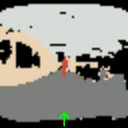
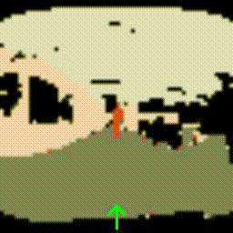
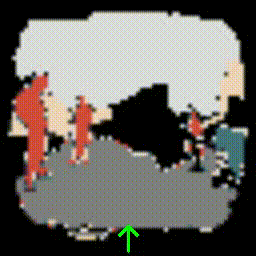
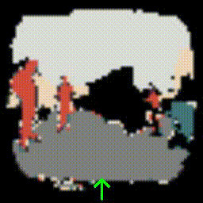
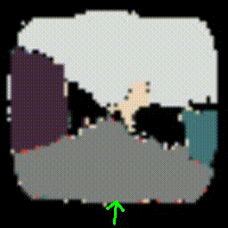
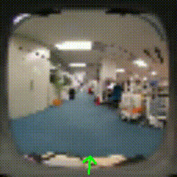
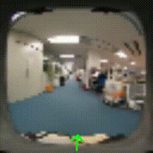
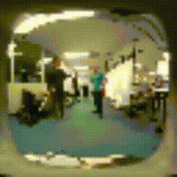
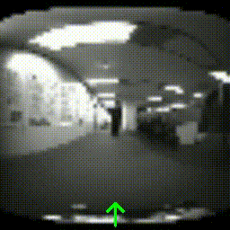
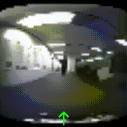

# mmVDT for Mobile-Robot Navigation

This is the implementation and qualitative results for the paper [“Action-Inclusive Multi-Future Prediction Using a Generative Model in Human-Related Scenes for Mobile Robots”](https://ieeexplore.ieee.org/document/11170425/metrics#full-text-header).

mmVDT is a multimodal diffusion-transformer model that jointly models future visual observations and robot motion. The repository includes RGB and panoptic/semantic inputs, VAE training, single- and multi-GPU diffusion training, and notebooks for qualitative and quantitative evaluation.

## Repository contents

- `TimeSformer/`: mmVDT model variants.
- `DDIM/`: diffusion sampling utilities.
- `dataset/`: dataset loader (datasets themselves are intentionally not versioned).
- `train_vae.py`, `train_VDT_*.py`: VAE and mmVDT training entry points.
- `eval/`, `eval_3c/`, and `evaluation*.ipynb`: metrics and analysis notebooks.
- `VDT_cat*.ipynb` and `data_generator.ipynb`: interactive inference and data-generation workflows.
- `MaskDINO/`: pinned third-party segmentation dependency, provided as a Git submodule.
- `assets/results/`: qualitative examples used below.

## Setup

Use Python 3.8 and a CUDA-compatible PyTorch installation. Clone with the segmentation dependency, then install the Python packages:

```bash
git clone --recurse-submodules https://github.com/innovation-x/mmVDT_robo_nav.git
cd mmVDT_robo_nav
pip install -r requirements.txt
pip install -r MaskDINO/requirements.txt
```

MaskDINO additionally requires Detectron2 and compilation of its CUDA extension; follow its [installation guide](MaskDINO/INSTALL.md) after initializing the submodule. Checkpoints, datasets, experiment logs, and generated metric tensors are excluded from Git because they are large, machine-specific artifacts.

## Results

The following examples compare observed sequences from the dataset with multiple future trajectories sampled by the model. The semantic and RGB result assets are incorporated from the companion [mmVDT result gallery](https://github.com/innovation-x/mmVDT_for_mobile_robot).

### Panoptic / semantic inputs

| Sample | Observed sequence | Generated future 1 | Generated future 2 | Generated future 3 |
| --- | --- | --- | --- | --- |
| 1 |  |  |  |  |
| 2 |  |  |  |  |
| 3 |  |  |  |  |

### RGB inputs

| Sample | Observed sequence | Generated future 1 | Generated future 2 | Generated future 3 |
| --- | --- | --- | --- | --- |
| 1 |  |  |  |  |
| 2 |  |  |  |  |
| 3 |  |  |  |  |

## Third-party software

The `MaskDINO` submodule remains under its own license. See [its repository](https://github.com/IDEA-Research/MaskDINO) and included license information for details.
